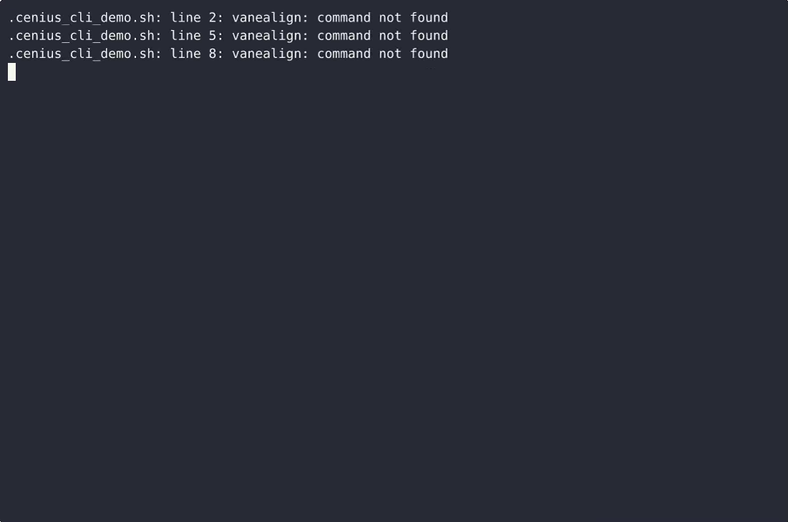

# VaneAlign — complete Full-stack app command-line tool example app

Build VaneAlign as a single-file, standard-library Python command-line tool that provides a telescope polar-alignment checklist, an eyepiece magnification table, and object seeing-conditions notes. That's **VaneAlign** — a Apache-2.0-licensed, open-source command-line tool in Full-stack app you can self-host and modify freely. Fork VaneAlign, run it, or [remix it on cenius.ai](https://cenius.ai/marketplace/p/vanealign?ref=gh&utm_campaign=vanealign-webapp) for a custom VaneAlign build with full rebrand rights.


[](LICENSE)  [](https://cenius.ai)

[](https://cenius.ai/marketplace/p/vanealign?ref=gh&utm_campaign=vanealign-webapp)

> **▶ [Open & edit in cenius.ai](https://cenius.ai/marketplace/p/vanealign?ref=gh&utm_campaign=vanealign-webapp)** — one click to an editable workspace: describe changes in plain English, get an instant preview, one-click deploy and host. Modifications made on the platform come with full rebrand & relicense rights.

_Local clone? See [Quick start](#quick-start) below. cenius.ai is the zero-setup path._

## Demo


📽 **[Demo video on cenius.ai](https://cenius.ai/marketplace/p/vanealign?ref=gh&utm_campaign=vanealign-webapp)** — the complete run-through · [MP4](.github/media/demo.mp4)

## Screenshots



## Quick start

```bash
./install.sh   # installs dependencies + seeds demo data
```

See [`INSTALL.md`](INSTALL.md) for full setup and usage instructions.

## Architecture

Open the repo and you'll find a complete Full-stack app application (27 files). Top-level layout: `demo/`, `tests/`, `vanealign.egg-info/`. `./install.sh` gets you from a fresh clone to a running instance with sample data in a single step. For environment-specific setup, see [`INSTALL.md`](INSTALL.md).

## Features

- Polar alignment checklist
- Eyepiece magnification table
- Object seeing-conditions notes

## Usage guide

Every screen is reachable two ways: from the interactive menu (`python3 vanealign.py`)
and directly by subcommand. Both read and write the same JSON data file.

Throughout, `q` at any prompt (or Ctrl-D) quits cleanly with exit code 0 and leaves
the saved data untouched.

### First run and the passphrase gate

```
$ python3 vanealign.py
  No data file yet at /home/you/.vanealign/vanealign.json.
  Set a passphrase to protect your checklist, eyepieces and notes.
  It is stored only as a salted PBKDF2 hash; there is no reset.
  new passphrase:
  confirm passphrase:
  Created /home/you/.vanealign/vanealign.json
```

The passphrase is stored as a salted PBKDF2-HMAC-SHA256 hash (120 000 iterations,
iteration count recorded in the file) and compared with `hmac.compare_digest`.
Later runs ask for it before showing the checklist, the eyepiece table or the log;
a wrong entry prints `Passphrase not recognised.` and re-prompts (three attempts)
without revealing a single saved row. There is no reset and no recovery — deleting
the data file is the reset.

### Alignment checklist

```
$ python3 vanealign.py align

  Align ──────────────────────────────────────────────────────────────
  2 of 7 steps done

_Full guide: [`USAGE.md`](USAGE.md)_

## FAQ

### Can I deploy VaneAlign on my own infrastructure?

Clone this repository and run `./install.sh`, then start the app as described in [`INSTALL.md`](INSTALL.md). VaneAlign is fully self-hostable — no external services are required to try it.

### Can I change VaneAlign without writing code?

[cenius.ai](https://cenius.ai/marketplace/p/vanealign?ref=gh&utm_campaign=vanealign-webapp) handles the implementation. Tell it what you want in everyday words, pick up the updated build. No coding needed.

### Does the VaneAlign license allow commercial use?

Yes — it ships under the Apache-2.0 license, which permits commercial use, modification and redistribution. The full text is in [LICENSE](LICENSE).

### Is it possible to white-label VaneAlign for a client?

White-labeling is supported: fork the MIT-licensed source and rebrand it yourself, or use [cenius.ai](https://cenius.ai/marketplace/p/vanealign?ref=gh&utm_campaign=vanealign-webapp) to make changes in a guided workspace — platform modifications come with full rebrand rights.

### Which framework or language does VaneAlign use?

The app is built with Full-stack app. What you see in this repo is the full production source, demo data included. Highlights include polar alignment checklist.

## License & rebranding

Released under the [Apache License 2.0](LICENSE) (© 2026 Cenius AI) — free for personal and commercial use. The Cenius name/logo are trademarks (see NOTICE).

**Need a customized version?** [Remix this app on cenius.ai](https://cenius.ai/marketplace/p/vanealign?ref=gh&utm_campaign=vanealign-webapp) — modifications made on the platform come with **full rebrand & relicense rights** over your derivative.

## Built with cenius.ai

This entire application — code, design, seeded demo data — was generated on **[cenius.ai](https://cenius.ai)** from a plain-English description.

- 🚀 [Build your own app on cenius.ai](https://cenius.ai)
- 🎛️ [Remix VaneAlign on the marketplace](https://cenius.ai/marketplace/p/vanealign?ref=gh&utm_campaign=vanealign-webapp) — open it in a workspace, prompt for changes, and ship your own version.

More open-source apps: [the Cenius-ai catalog](https://github.com/Cenius-ai) · [showcase index](https://github.com/Cenius-ai/showcase)
